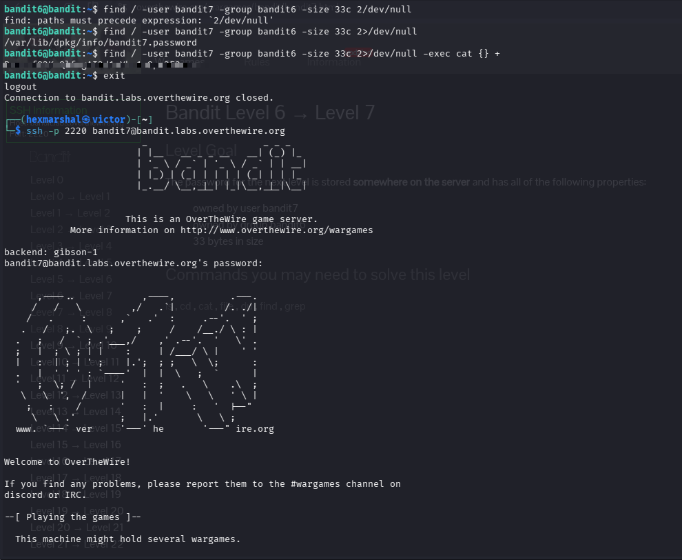

# Level6 - Level7
**Level Goal**
The password for the next level is stored somewhere on the server and has all of the following properties:
- owned by user bandit7
- owned by group bandit6
- 33 bytes in size

**Objective** 
Candidates will learn how to search the entire filesystem by ownership using `find`, how to silence noisy error messages with output redirection, and how to run a command on the files `find` matches.

**Need to know about searching by ownership, `2>/dev/null` and `-exec`**

**Searching by owner and group**: Every file on a Linux system belongs to a user and a group. `find` can filter on these with:
- `-user <name>` — match files owned by that user.
- `-group <name>` — match files owned by that group.

Since the password could be anywhere on the server, the starting path is `/` (the root of the filesystem) instead of `.`.

**Silencing errors with `2>/dev/null`**: Searching from `/` means `find` tries to enter directories our user isn't allowed to read, and it prints a `Permission denied` error for each one, burying the real result in noise. Linux programs have separate output streams, and error messages go to a stream called **stderr**, identified by the number `2`. 
- `>` redirects a stream somewhere else.
- `/dev/null` is a special "black hole" file that discards anything written to it.

So `2>/dev/null` means "send all error messages to the black hole," leaving only the actual results on screen. Note that `2>` must be written with no space between the `2` and the `>`. Writing `2/dev/null` instead makes the shell pass it to `find` as a stray argument, which is exactly the `paths must precede expression` error seen in the screenshot.

**Running a command on results with `-exec`**: `find` can hand every match to another command using `-exec <command> {} +`. 
- `{}` is a placeholder that gets replaced by the matched file path(s).
- `+` marks the end of the `-exec` expression (and bundles all matches into a single command run).

So `-exec cat {} +` finds the file and reads it in one go, with no need to copy the path and run `cat` separately.

# SOLVING LEVEL 7
Having SSHed into bandit.labs.overthewire.org level6

**STEPS**

* Search the whole server for a file matching all three properties. Our first attempt used ``find / -user bandit7 -group bandit6 -size 33c 2/dev/null`` but the missing `>` caused an error, so we correct it:

    ``find / -user bandit7 -group bandit6 -size 33c 2>/dev/null``

    $OUTPUT: /var/lib/dpkg/info/bandit7.password
* The file is found. We can read it directly with ``cat /var/lib/dpkg/info/bandit7.password``, or let `find` do both steps at once using ``find / -user bandit7 -group bandit6 -size 33c 2>/dev/null -exec cat {} +``
Boom!!! The password is revealed. 

