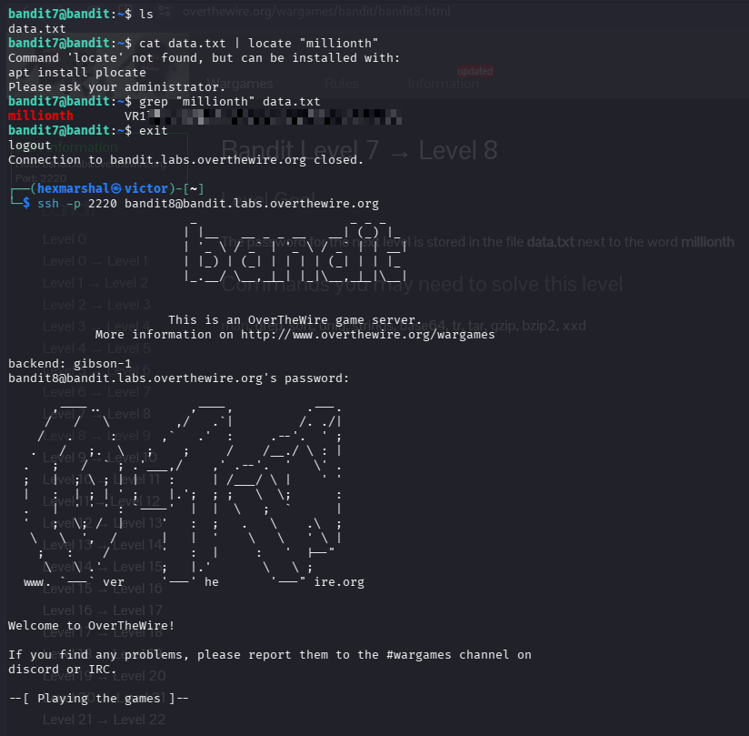

# Level7 - Level8
**Level Goal**
The password for the next level is stored in the file `data.txt` next to the word `millionth`

**Objective** 
Candidates will learn how to search for a specific word or pattern inside a file's content using `grep`, instead of scrolling through a huge file by eye.

**Need to know about the `grep` command**

**The `grep` command**: `grep` scans a file line by line and prints only the lines that contain a given word or pattern. This is invaluable when a file is far too large to read manually (like `data.txt` here, which holds thousands of lines) and you only care about the line(s) containing a keyword.

The basic syntax is:

```
grep "<pattern>" <file>
```

**`grep` vs `locate`**: It's easy to confuse tools that "search". `grep` searches *inside* the content of files, while `locate` (and `find`) search for files by *name or attributes*. Since our goal is to find a word inside `data.txt`, not to find a file, `grep` is the right tool. Our first attempt, ``cat data.txt | locate "millionth"``, was the wrong approach: `locate` isn't even installed on the server, and even if it were, it only looks up filenames, not text piped into it.

# SOLVING LEVEL 8
Having SSHed into bandit.labs.overthewire.org level7

**STEPS**

* ``ls`` in the home directory to see the files/folder present in it. 

    $OUTPUT: data.txt
* The file is far too big to read by eye, so we search it for the keyword with ``grep "millionth" data.txt``

    $OUTPUT: `millionth` followed by the password on the same line.
Boom!!! The password is revealed. 


